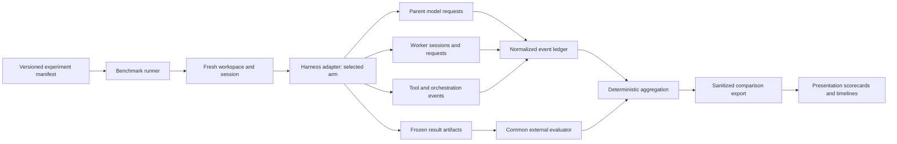

# Reusable harness benchmark

Date: 5 November 2026

Status: approved on 5 November 2026 with the condition that the benchmark supports useful comparisons across harnesses. That condition is incorporated below. No implementation, installation or provider trials performed under this design.

## Intent and chosen approach

Build a harness-independent measurement and evaluation core, integrated first with the global OpenCode harness, then import its evidence into the interactive presentation. Answer when one session, sequential workers, parallel workers, and model routing improve or worsen validated outcomes. Preserve negative results and uncertainty; success is a trustworthy comparison, not a demonstration that orchestration always wins.

The owner selected **reusable harness benchmark** after considering an export-based pilot. The reusable approach requires native instrumentation and execution-policy work but supports repeatable future comparisons. Export-only analysis would be quicker but could omit attempts, child calls, and concurrent timing. Static hypothetical examples remain useful teaching material but cannot establish empirical performance.

Implementation belongs in `/home/joshl/projects/opencode-harness`; presentation integration belongs in this repository. This document stays here as the cross-project design. The builder should reference it from the harness implementation plan rather than maintain divergent specifications.

Owner requirements: matched task prompts, same-model comparisons, routed worker variants, all five presentation dimensions (context, quality, cost, latency, control), per-session/orchestration artifacts, and parallel researchers, implementers and validators where dependencies permit. Development/review subagents use GPT-6.1 Sol. Benchmark worker models are separately declared experimental inputs; the owner's proposed multi-model experiments do not change the development-agent restriction.

## Observed starting point

Read-only inspection found:

- The installed global entry points to package 0.1.20, release suffix `fc523d34ba84d4fc316d`. This establishes on-disk selection, not which release a running service has loaded.
- `global-native-plugin.ts` persists `protocol.jsonl` below the external state tree, keyed by session and orchestration. Its protocol calls represent orchestration/tool activity, not a proven inference ledger.
- `validateUsageTelemetry` currently accepts reported input tokens, output tokens and USD cost. Missing measurements stay null. Cache categories, timing and per-inference identity need an additional schema without silently changing existing consumers.
- The context helper injects automatic delegation guidance into primary sessions. A benchmark baseline must explicitly override this treatment for benchmark-owned sessions.
- The global adapter rejects `background: true`; legacy Job support is a different profile. This alone does not prove that concurrent foreground calls are impossible. Verify native dispatch behavior and correlation before selecting a concurrency transport.
- Existing paired fixtures materialize 10 small synthetic tasks across two arms and three repeats. Their checks are useful for runner regression tests, not representative engineering-work results. Preserve that suite and its historical meaning.
- The harness uses authored TypeScript and generated runtime JavaScript, release inventories, global installation validation and independent acceptance gates. Extend those mechanisms; do not introduce a second competing global plugin or bypass existing admission.

Primary local references: `AGENTS.md`, `docs/global-profile.md`, `docs/refinement-evaluation.md`, `.opencode/src/plugin-modules/global-native-plugin.ts`, `global-protocol.ts`, `context-budget.ts`, and `.opencode/scripts/prepare-paired-benchmark.mts` in the harness repository.

## Experimental matrix

### Portability and the scope of conclusions

Task bundles, prompts, external evaluators, event definitions, accounting rules and report generation must work without OpenCode session APIs or its four-role protocol. Keep those dependencies inside the OpenCode adapter. A documented adapter contract plus an offline canonical-event import path must allow another harness to supply the same measurements. Verify portability with a second, deliberately different synthetic adapter and golden-trace conformance suite; label that proof as schema/semantic interoperability, never live evidence for a second harness.

Every run records harness name/version, adapter/version, actual configuration, tool affordances, observed models, instructions/policies, transport and coverage. Distinguish native harness steps from normalized model requests, tools, delegations and elapsed time. Unknown data remains unknown even when another adapter exposes it. The core accepts arbitrary worker roles; only the OpenCode adapter enforces its four existing role names.

Reports support both within-harness A–E comparisons and matched comparisons across harnesses. Stratify by harness first. A comparability check flags differences in task/evaluator hashes, models/reasoning settings, permissions/tools, budgets, cache policy and measurement coverage. Unsupported arms are explicit. Do not pool unequal configurations into a single winner or present a capability gap as zero cost. Extrapolation is a qualified hypothesis until replicated: portable tasks and metrics let others reproduce the experiment, while measured speedups and savings apply to the tested configurations. Show the evidence scope and limitations alongside every result.

Initial delivery includes the OpenCode live adapter, portable core, canonical importer, conformance suite and harness-aware reporting. Real Claude Code, Codex or custom-harness collectors are follow-on adapters unless explicitly added; no live integration with those products is implied. A cross-harness empirical conclusion requires matched real runs from at least a second harness and enough tasks/repeats to support the claimed scope. The presentation must not imply that one additional run establishes generality.

| Arm | Main session | Worker models | Worker scheduling |
| --- | --- | --- | --- |
| A | GPT-6.1 Sol | None | Single session; no delegation |
| B | GPT-6.1 Sol | Sol throughout | Sequential |
| C | GPT-6.1 Sol | Sol throughout | Concurrent independent tasks |
| D | GPT-6.1 Sol | Explicit routing profile | Sequential |
| E | GPT-6.1 Sol | Same profile as D | Concurrent independent tasks |

These are requested display labels, not verified provider IDs or availability claims. Preflight resolves exact provider/model IDs, versions or returned aliases, reasoning settings, limits and accounting mode. Unavailable models block the affected arm; there is no silent substitution. Freeze and hash the model/routing configuration before trials.

Initial routed candidate: Terra for research, Astra for planning, Luna for bounded implementation and validation, Sol for orchestration, following the owner's example. Suitability is a hypothesis. Freeze the mapping for the pilot; adaptive escalation is a later, separately identified arm whose retries and escalation costs must be counted. The same deterministic external evaluator judges all arms.

Comparisons: A/B measures the complete delegation-policy treatment, including role prompts, isolation and internal review. B/C and D/E compare scheduling. B/D and C/E compare routing under the corresponding policy. Adaptive models may choose different decomposition or tool use; the main experiment measures the policy's end-to-end effect, not a pure causal estimate of context isolation or scheduling alone. Record realized task graphs. A later controlled-graph experiment may hold task packets fixed across worker arms and must be labeled separately.

Model routing, scheduling and delegation policy are manifest fields, not edits to the natural-language task prompt. Record all actual instruction and role-protocol differences. A has no orchestration instructions or delegation tools, while retaining ordinary tools, shared task instructions, skills and evidence access. A must not accidentally inherit automatic orchestration through a skill, context hook or compaction restore. B–E use existing managed admission and independent validator gates. This is an explicit benchmark-only direct-session policy, never a general guard bypass or an assertion that A passed managed-orchestration acceptance.

## Tasks, fairness and trial execution

Proposed pilot: three task families × five arms × three repeats = 45 runs per fully supported harness, preceded by a small separately labeled instrumentation smoke set. Additional harnesses multiply that budget and require their own launch configuration. Three repeats are exploratory, not adequate evidence for precise tail percentiles or universal rankings.

1. Coupled bug fix: fix order idempotency across request handling and persistence, including duplicate/concurrent requests, while preserving the API contract. A useful counterexample to unnecessary delegation.
2. Separable feature: implement independently owned API and client components against a frozen interface, then integrate and test. Parallel writes use separate worktrees/artifacts; merge time and conflicts belong to the workflow.
3. Evidence investigation: analyze a fixed bundle of requirements, incident records and code, then produce a diagnosis and remediation proposal with source references. Independent sources permit parallel research; review is grounded in a prewritten evidence rubric.

Build versioned, shareable fixture repositories and a fixed source bundle. Do not use unrestricted changing web search in the core matched pilot. Freeze task prompt, starter commit/content hash, dependencies, evidence, tool availability, acceptance rules and evaluation version. Broader real-repository tasks can be added with the same contract later.

Each run gets a fresh worktree or verified disposable copy, fresh sessions, isolated writable artifacts and no access to other arms' answers. Reuse identical dependency artifacts where safe; include their provenance. Shared memory is frozen read-only or disabled consistently. No prior trial output enters later context. Schedule arms in seeded randomized blocks per task/repeat. Run different trial arms sequentially by default to avoid external contention; allow concurrency inside C/E only. Record service tier, observed rate limits, host load and any external contention.

Match permissions, task evidence, reasoning settings where supported, maximum elapsed time, aggregate spend ceiling and intervention policy. Limits are configuration, applied across parent and descendants, not multiplied per worker. Missing actual billing does not allow claiming a hard dollar cap; estimated-cost caps require complete rates/usage and conservatively reserved in-flight budgets. Otherwise use request/token/time/concurrency limits and state the dollar enforcement gap. Final numeric live limits and account/transport are launch-manifest inputs, not implied by this design approval.

Primary pilot cache policy is natural provider behavior with identical cache configuration and randomized order, explicitly not guaranteed cold. Record cache reads/writes and reuse conditions. Do not bust caches by changing task text. Controlled cold/warm experiments require supported isolation and separate labels. A cache advantage is part of an observed run; disclose cross-run/account caching uncertainty.

Before evaluation, freeze the produced output. Run the same external acceptance commands against every arm's final artifact, with identical limits. Hidden regression cases and a prewritten evidence rubric prevent success by changing visible tests. Check evaluator/test hashes. Automated checks are primary; any blinded human review records rubric scores and reviewer identity separately. Model self-reported success is not acceptance.

No steering after launch except a uniform predefined clarification policy. Record every human intervention. Failed, timed-out, cancelled and infrastructure-invalid attempts remain visible; replacements receive new IDs and explicit reasons. Resuming data collection does not resume a previously interrupted managed authorization or child task.

## Architecture and native capability contract



The reusable facility comprises: a portable task/experiment manifest validator, adapter capability preflight, a metadata-only collector, deterministic event normalization and reconciliation, an isolated runner, evaluator adapters and a public export/report generator. Keep portable modules free of native OpenCode imports and test their published package closure in an empty directory. Ship collection opt-in and benchmark-scoped initially. Public command spelling is left to the builder; support prepare, preflight, run, evaluate, report and export responsibilities, with prepare/report usable offline.

Pin the actual OpenCode binary and inspect its native hook/type implementation. Current documentation identifies `context`, `compaction`, `title`, `generate`, `model.request`, HTTP, experimental WebSocket and retry hooks. Hook availability and callback timing must be proven for the chosen build. A prompt admission hook is not an inference counter. A context hook alone cannot prove network attempts or completed billing. HTTP-only observation misses WebSocket inference. Avoid draining or altering streamed response bodies. Prefer native completed usage events/export where reliable; if protocol parsing is necessary, isolate tested adapters by transport/provider and preserve payload behavior.

Coverage preflight outputs supported/unsupported/unknown per operation and transport, including parent and child calls, auxiliary generation, retry attempts, cache usage, cancellation and completion. Reconcile observed attempts, completed usage and native session totals without treating cumulative snapshots as deltas. An unsupported measurement remains null with a reason. Required call/lineage coverage gaps prevent claiming a fully measured comparison; they do not become zero usage.

Telemetry never authorizes tasks, satisfies validation gates or modifies model output. A collector failure marks the run measurement-incomplete, records diagnostics and stops new benchmark scheduling; native task termination must still be established through existing controls. No output acceptance follows from telemetry success.

## Event identity and artifacts

Use schema-versioned, append-only events with event ID, per-process sequence, wall timestamp, monotonic timing and emitter identity. Correlate experiment ID, run ID, root session ID, child session ID, parent ID, orchestration ID, delegation/task ID, logical inference ID, physical attempt ID, tool call ID and native/provider IDs where exposed. Missing native correlation is explicit; do not infer it from nearby timestamps alone. Streaming chunks, replayed hooks and completion notifications are not additional model calls.

Record operation kind (primary, compaction, title, transient generation, evaluator), exact model/provider/variant, requested versus observed route, start/end/status, retry reason, normalized token categories, native usage semantics, and accounting provenance. Distinguish delegated worker run count, logical generation count, physical attempts and completed model responses. Tool events have separate spans; a shell script's internal commands are not separate tool requests unless natively observed as such.

Suggested private artifact bundle per run:

```text
manifest.json          # task/config/build hashes, seed, account mode without secrets
coverage.json          # observed capability and reconciliation gaps
events.jsonl           # normalized allowlisted metadata; parent and child linkage
usage.json             # reconciled usage and pricing provenance
outcome.json           # final status, acceptance, interventions and artifact hashes
evaluation/            # command results, rubric records and test evidence
artifacts/             # patches, answers and approved evidence references
summary.json           # deterministic derived metrics
```

Keep existing protocol traces and correlate them; do not duplicate their costs into totals. Ordinary single sessions get the same bundle shape with orchestration fields null. Store under an owner-only external benchmark state root, indexed by run/session/orchestration. Default telemetry contains no credentials, headers, raw prompts, reasoning text, complete tool outputs or private paths. Task text and approved fixture evidence are separately controlled artifacts. Unknown schema fields are rejected or excluded by an explicit migration policy. Apply existing no-follow path/ownership rules, append failure handling and manifest inventories.

On restart, report interrupted runs from durable evidence; do not reconstruct managed authority. Never label an active child terminated merely because collection stopped. Public export uses an allowlist, stable pseudonymous IDs and relative approved artifact references; no private bundle is served directly by GitHub Pages.

## Metric definitions

| Dimension | Definition and reporting |
| --- | --- |
| Context | Provider-reported input/output; uncached, cache-read and cache-write categories where distinguishable; sum across calls; peak input per call; compaction count. Context-category attribution is exact only with defensible tokenizer/request-boundary evidence; otherwise labeled estimate or unavailable. |
| Quality | External acceptance and regression results; evidence rubric; number of corrective attempts and interventions. Report task-specific results before any aggregate score. |
| Cost | Sum all attributable parent, worker, retry and auxiliary usage, plus tool fees where available. Separate actual provider charges, native reported cost, rate-derived API equivalent, and subscription quota. Never convert a zero subscription cost field into free compute. |
| Latency | First task admission to workflow-terminal timestamp; separately external evaluation duration and prompt-to-validated-result elapsed time. Include waits, merges, retries and internal validation. Report model/tool/queue time only where boundaries are observed. |
| Control | Permission requests, human actions, refusals, scope violations, cancellation outcome, recovery attempts and unresolved children. Distinguish an enforced prevention from a successful result. |

Preserve raw reported usage and normalize according to provider semantics. Do not double-count reasoning included in output or cache categories included in input. Cache-write/read rates, retention tiers, context thresholds and service tiers belong to a dated pricing snapshot with source URLs. Record model-window utilization only using verified limits for that call; peak input is not complete context occupancy when output/reasoning is unknown. Summed worker durations are compute activity, not wall-clock latency. Peak concurrent workers and observed overlap substantiate parallelism; DAG critical paths require known dependency edges.

Report per task and arm: every run, accepted/attempted count, median and range of time/cost, missing-data count and paired differences. Cost per accepted result is total attempted workflow cost divided by accepted count, including failed runs; with zero accepts report undefined alongside total spend. Partial cost coverage cannot yield an exact total or exact savings percentage. External evaluator resource cost is separate and applied equally. Report instrumented runtime overhead from a controlled fixture check so collection itself is visible.

## Parallel execution

Use existing four roles and mode contracts. Parallel researchers read independent evidence, implementers own separate files/components, and validators review fixed artifacts. Dependencies and merge responsibilities are explicit. Default pilot concurrency proposal: at most three live workers per run, configurable and recorded. Conflicting writes serialize or run in separate worktrees with an accountable integration stage. Fresh IDs and independent validation still apply.

First test whether native concurrent foreground subagent invocations provide correct overlap, child identity and completion/cancellation correlation. If supported, extend the global adapter conservatively around that path. If not, implement a native supported background/completion path with explicit identity, termination and late-result proof; do not import legacy Job assumptions. Native transport changes must retain the global profile boundary and no broad stop behavior. Offline simulations cannot certify concurrency on the live build. If native support is unavailable, C/E remain visibly unsupported until the scoped enhancement passes; sequential runs must not masquerade as parallel results.

## Presentation integration

Import a versioned public comparison JSON generated from the artifacts, not hand-entered totals. Provide an arm selector and side-by-side timeline with separate parent, worker and tool lanes. Show task prompt, settings, acceptance evidence, total cost/accounting mode, elapsed time, peak/cumulative input and interventions. Calls open usage/details; workers expand into multiple calls. Show repeated-run distributions and all attempts, with an explicit measured/hypothetical label. Retain existing hypothetical teaching examples separately. All public values trace to a run ID and evidence record. Implement within the existing static GitHub Pages architecture; no hosted telemetry backend is required.

## Delivery and verification

1. Capability and schema tranche: read actual native surfaces; prove event identity, stream transparency, token normalization and baseline policy. Offline tests and captured sanitized fixtures first.
2. Sequential runner tranche: A/B/D, task isolation, external evaluation and durable reports. Recording is identical across arms. No default global behavior changes.
3. Parallel tranche: prove native overlap and failure handling, then C/E. All five arms are required for the intended benchmark delivery; intermediate tranches are not overall completion.
4. Instrumentation smoke runs and pilot: resolve exact models, account mode and explicit limits; record installed/active release provenance. Perform smoke checks before the proposed 45-run suite. No paid trial starts from an unspecified budget.
5. Presentation: import sanitized measured artifacts; browser-test timeline/detail navigation, arithmetic, missing-data states and existing lifecycle modals; publish through the already authorized Pages workflow after review of the public export.

Meaningful tests cover duplicate/reordered events, retries, cancellation, missing usage, HTTP/WebSocket continuations, compaction/title accounting, child linkage, threshold/cache pricing, evaluator tampering, cross-run contamination, concurrent writes/merges and collector interruption. Use invariant/fixture tests rather than matching implementation output. Run required harness format/type/generated/policy/global/source/runtime/package checks for changed surfaces; preserve existing suites. Independently review the implementation before installed activation.

Source development and offline validation are the next implementation scope once this design is approved. Installed release replacement, service restart and paid trials need a concrete reviewed release/launch manifest with account and bounds; do not infer those values from approval of the architecture. Existing authorization to publish the presentation persists, but publishing private traces is outside that scope.

## Builder choices and remaining launch inputs

Builder may choose internal module names, command spelling, event storage indices, report styling and exact fixture implementation while preserving the contracts above. Proposed defaults are the three task families, three repeats, natural caching, max three concurrent workers, TypeScript/Node 24 on WSL, and static report export. These are recommendations, not prior owner decisions.

Before live execution, resolve exact active OpenCode build, provider access/model IDs, account mode, numeric per-run/suite limits, approved task fixture versions and service restart timing. These do not block offline implementation. Any provider capability that contradicts the design must be reported with evidence rather than simulated as a live success.

External reference consulted during initial discovery: https://opencode.ai/v2/docs/build/plugins/server#model-requests (5 November 2026). Native installed source and verified runtime behavior remain authoritative for compatibility; current documentation is not proof of installed hook support.

## Design review

A fresh GPT-6.1 Sol builder check on 5 November 2026 reported “nothing important left” for implementation-plan readiness of the initial design. The owner subsequently approved with the portability condition above. The implementation plan must cover that added condition; the original review did not certify a cross-harness implementation or live capability.
